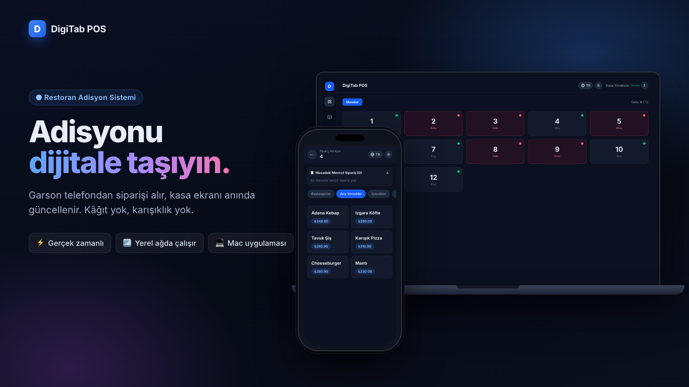

# DigiTab POS

Restoran ve kafeler için yerel ağda çalışan adisyon sistemi. Garsonlar siparişi telefondan alır, kasa ekranı anında güncellenir.



## İndir ve kur

Kurulum için terminal veya programlama bilgisi gerekmez.

1. **[Son sürümü indirin](https://github.com/FatihAksoyEEE/DigiTab/releases/latest)**. Windows için `.exe`, Mac için `.dmg` dosyasını seçin.
2. Dosyayı çift tıklayıp kurun. Kurulumda çıkabilecek güvenlik uyarılarının nasıl geçileceği indirme sayfasında adım adım anlatılıyor.
3. Uygulamayı açın, güvenlik duvarı sorarsa **İzin Ver**'i seçin.
4. Garsonlar, **Ayarlar** sayfasındaki QR kodu aynı Wi-Fi'daki telefonlarıyla okutarak bağlanır.

## Özellikler

- **Kasa paneli:** Masaların dolu/boş durumu, açık adisyonlar, sipariş notları, adet düzenleme ve masa kapatma.
- **Garson ekranı:** Uygulama kurmadan, telefon tarayıcısından QR kodla erişilir. Kategorili menü, sepet ve sipariş notu içerir.
- **Gerçek zamanlı:** Socket.io ile tüm ekranlar anında senkronize olur.
- **Menü ve ayarlar:** Kategori/ürün yönetimi, masa sayısı, restoran bilgileri ve tek tıkla yedekleme (son 20 yedek saklanır).
- **Açık/koyu tema, Türkçe/İngilizce.**
- **İnternet gerekmez:** Veriler kasa bilgisayarındaki SQLite dosyasında tutulur.

## Teknoloji

Next.js 16 (App Router) + özel Node sunucusu (`server.ts`), Socket.io, SQLite (better-sqlite3), Tailwind CSS 4. Masaüstü sürümü Electron ile paketlenir.

## Geliştirme

Node.js 20 veya üzeri gerekir.

```bash
npm install
npm run dev            # http://localhost:3000
```

Sunucu açıldığında terminalde garson telefonlarının kullanacağı yerel ağ adresi yazılır. Aynı adres ve QR kodu **Ayarlar** sayfasında da bulunur.

| Komut | Açıklama |
|---|---|
| `npm run dev` | Geliştirme sunucusu |
| `npm run build` / `npm start` | Üretim derlemesi ve sunucusu |
| `npm run electron:dev` | Masaüstü uygulamasını geliştirme modunda açar |
| `npm run dist` | Bu bilgisayarın işletim sistemi için kurulum dosyası üretir (`dist/`) |
| `npm run lint` / `npm run typecheck` | Kod denetimi |

## Güvenlik modeli

- **Kasa paneli, menü, ayarlar ve yedekleme** yalnızca kasa bilgisayarından (`localhost`) kullanılabilir. Ağdaki diğer cihazlar `/dashboard` adresine girdiğinde garson ekranına yönlendirilir ve yönetim işlemleri sunucu tarafından reddedilir.
- **Garson cihazları** yalnızca sipariş verebilir. Fiyatlar istemciden alınmaz, her zaman menüden okunur.
- Tüm socket olayları sunucuda doğrulanır (kimlik, adet, fiyat ve metin uzunluğu). Başka web sitelerinden açılan WebSocket bağlantıları reddedilir.
- Uygulamada kullanıcı girişi yoktur; sistemi yalnızca güvendiğiniz bir yerel ağda çalıştırın.

## Proje yapısı

```
server.ts                 HTTP + Socket.io sunucusu (tüm veri değiştiren işlemler)
main.js                   Electron ana süreci
src/app/actions.ts        Salt okunur sunucu fonksiyonları
src/app/dashboard/        Kasa paneli, menü ve ayarlar
src/app/waiter/           Garson ekranı
src/components/           Ortak bileşenler (AppShell, tema/dil düğmeleri)
src/lib/                  Veritabanı, socket istemcisi, tipler, çeviriler
promo/                    Tanıtım görselleri ve videosu
```

Veritabanı geliştirmede proje kökündeki `sqlite.db` dosyasıdır. Masaüstü uygulamasında ise işletim sisteminin kullanıcı veri klasöründe tutulur. Geçmiş siparişlerde kullanılan ürünler silindiğinde arşivlenir, böylece eski adisyonlar bozulmaz.

## Yeni sürüm yayınlama

`package.json` içindeki `version` alanını artırın, ardından aynı numarayla bir etiket gönderin:

```bash
git tag v1.0.1 && git push origin v1.0.1
```

GitHub Actions, macOS (Apple Silicon ve Intel) ile Windows kurulum dosyalarını derleyip [Releases](https://github.com/FatihAksoyEEE/DigiTab/releases) sayfasında yayınlar.
