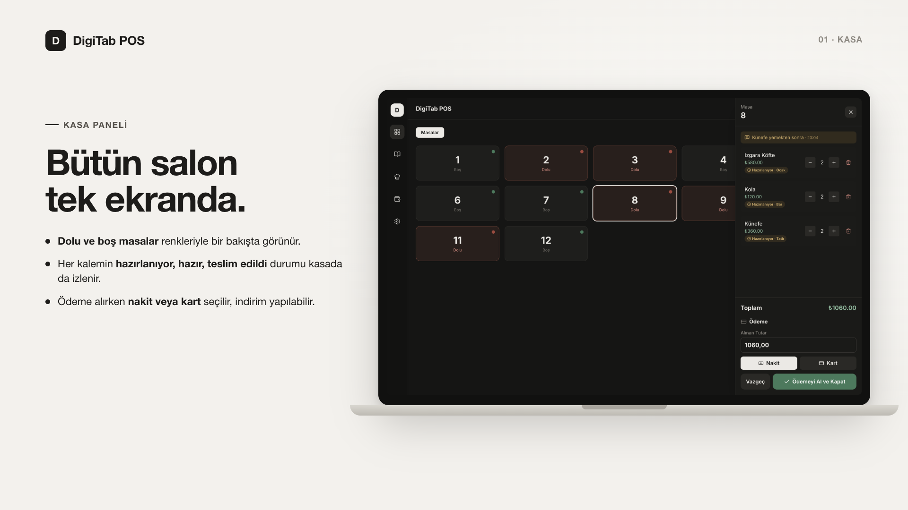
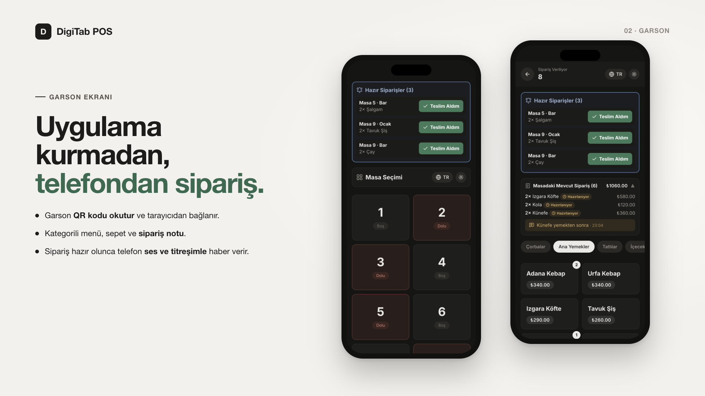
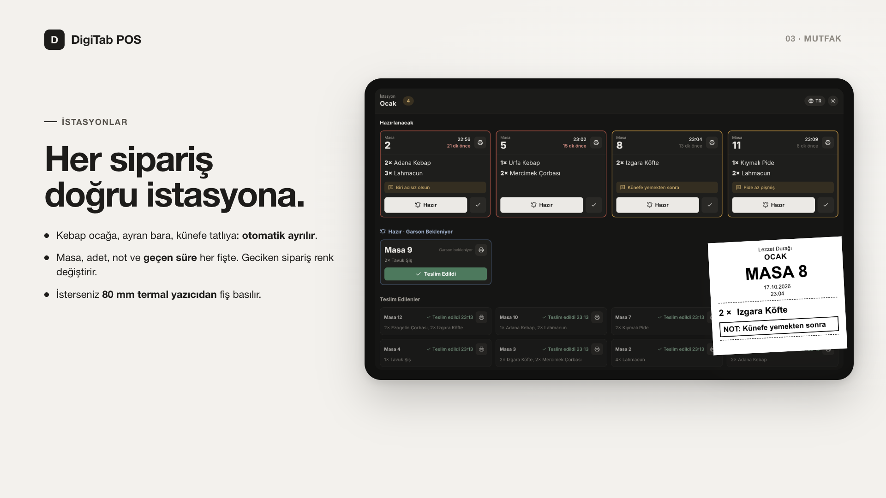
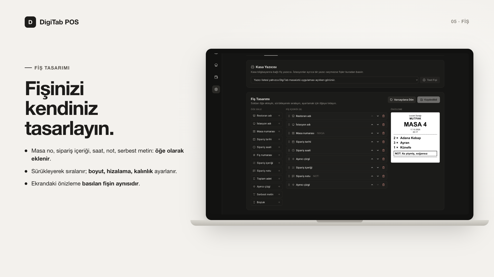
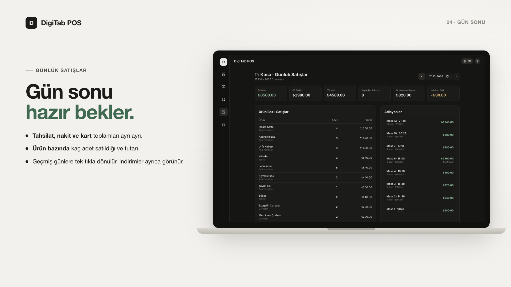
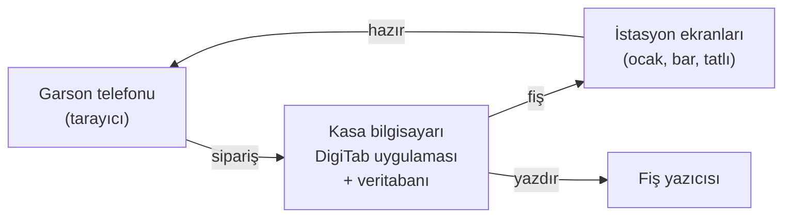

# DigiTab POS

**Restoran ve kafeler için kendi bilgisayarınızda çalışan adisyon sistemi.** Garson siparişi telefondan alır, sipariş mutfakta doğru istasyona düşer, hazır olunca garsonun telefonu titrer, kasa her şeyi anında görür ve gün sonu raporu hazır bekler. İnternet bağlantısı, abonelik ya da garson telefonlarına uygulama kurulumu gerekmez.


▶️ **[Tanıtım videosunu izleyin](promo/digitab-tanitim.mp4)** (28 sn)

## İndir

| Bilgisayar | Dosya |
|---|---|
| Windows 10 / 11 (64 bit) | [DigiTab-POS-1.1.0-win-x64.exe](https://github.com/FatihAksoyEEE/DigiTab/releases/download/v1.1.0/DigiTab-POS-1.1.0-win-x64.exe) |
| Mac (Apple M1, M2, M3, M4) | [DigiTab-POS-1.1.0-mac-arm64.dmg](https://github.com/FatihAksoyEEE/DigiTab/releases/download/v1.1.0/DigiTab-POS-1.1.0-mac-arm64.dmg) |
| Mac (Intel işlemcili) | [DigiTab-POS-1.1.0-mac-x64.dmg](https://github.com/FatihAksoyEEE/DigiTab/releases/download/v1.1.0/DigiTab-POS-1.1.0-mac-x64.dmg) |

Tüm sürümler ve kurulum adımları: **[Releases](https://github.com/FatihAksoyEEE/DigiTab/releases/latest)**. Kurulum için terminal veya programlama bilgisi gerekmez.

## Neden DigiTab?

- **Aylık ücret yok.** Bir kez kurarsınız, masa, garson ve cihaz sayısına göre ücret ödemezsiniz.
- **İnternet kesilse de çalışır.** Bütün sistem restoranın kendi Wi-Fi ağında döner. Bağlantı gitse de servis durmaz.
- **Verileriniz sizde kalır.** Siparişler ve satışlar kasa bilgisayarındaki tek bir dosyada tutulur. Hiçbir sunucuya gönderilmez.
- **Garsona uygulama kurdurmazsınız.** Herhangi bir telefon QR kodu okutarak tarayıcıdan bağlanır. Personel değişince yapılacak bir şey yoktur.
- **Mutfak ekranı ve fiş yazıcısı dahil.** İstasyon ekranları, hazır bildirimi, termal fiş ve gün sonu raporu ek modül olarak satılmaz.
- **Dakikalar içinde kurulur.** Kurulum dosyasını çalıştırın, restoran adınızı ve menünüzü girin, başlayın.

## Özellikler

### Kasa paneli


- Bütün masalar tek ekranda; dolu ve boş masalar renkleriyle ayrılır.
- Masanın adisyonu, sipariş notları ve her kalemin hazırlık durumu (hazırlanıyor, hazır, teslim edildi).
- Adet artırma/azaltma, kalem silme.
- **Ödeme alma:** alınan tutar girilir (indirim yapılabilir), nakit veya kart seçilir.

### Garson ekranı


- Uygulama kurmadan, telefon tarayıcısından **QR kodla** bağlanılır.
- Masa seçimi, kategorili menü, sepet ve sipariş notu.
- Masanın mevcut siparişi ve her kalemin durumu.
- **Hazır bildirimi:** sipariş hazır olunca telefon ses ve titreşimle uyarır, garson "Teslim Aldım" ile onaylar.

### İstasyonlar ve mutfak ekranı


- Ocak, bar, tatlı gibi istasyonlar oluşturulur. Menüde her kategoriye bir istasyon atanır, gerekirse ürün bazında değiştirilir.
- Sipariş gelince her kalem **otomatik olarak kendi istasyonuna** düşer; ayran bara, kebap ocağa gider.
- İstasyon ekranı mutfaktaki bir tablette ya da ekranda açılır. Yeni sipariş sesli uyarıyla gelir.
- Her fişte masa no, adet, not, sipariş saati ve **geçen süre** vardır. 8 dakikayı geçen fiş sarı, 15 dakikayı geçen kırmızı çerçeveyle öne çıkar.
- "Hazır" ve "Teslim Edildi" adımları kasa ve garson ekranlarına anında yansır.

### Fiş yazdırma ve fiş tasarımı


- İstasyon fişleri **80 mm termal yazıcıdan** basılır (USB veya sürücüsü kurulu her fiş yazıcısı).
- Yazıcı kasa bilgisayarına bağlıysa fiş **yazdırma penceresi açmadan** doğrudan basılır.
- Yazıcı mutfaktaki cihaza bağlıysa fiş o cihazdan basılır.
- **Fiş tasarımcısı:** restoran adı, istasyon, masa no, tarih, saat, fiş no, sipariş içeriği, not, toplam adet, ayırıcı çizgi ve serbest metin öğe olarak eklenir. Öğeler sürüklenerek sıralanır, boyut, hizalama ve kalınlıkları ayarlanır. Canlı önizleme basılacak fişin birebir aynısıdır.

### Günlük satışlar


- Günün tahsilatı, nakit ve kart toplamları, kapatılan adisyon sayısı, ortalama adisyon ve indirimler.
- Ürün bazında satılan adet ve tutar.
- Kapatılan adisyonların saat, masa ve ödeme türüyle listesi.
- Geçmiş günlere tek tıkla dönülür. Satış kayıtları, menü veya masa düzeni sonradan değişse de bozulmaz.

### Diğer
- **Gerçek zamanlı:** bütün ekranlar aynı anda güncellenir.
- **Menü yönetimi:** kategori ve ürün ekleme. Satılmış bir ürün silindiğinde arşivlenir, eski adisyonlar bozulmaz.
- **Yedekleme:** tek tıkla veritabanı yedeği; son 20 yedek saklanır.
- **Açık ve koyu tema, Türkçe ve İngilizce arayüz.**

## Benzer çözümlerle karşılaştırma

Restoranlar genellikle üç yoldan birini kullanır: kâğıt adisyon, bulut tabanlı abonelikli adisyon uygulamaları ya da lisanslı klasik POS yazılımları. Aşağıdaki tablo bu kategorilerin tipik özelliklerini karşılaştırır; tek tek ürünler farklılık gösterebilir.

| | Kâğıt adisyon | Bulut tabanlı adisyon uygulamaları | Klasik lisanslı POS | **DigiTab POS** |
|---|---|---|---|---|
| Maliyet | Kâğıt, kalem | Genellikle aylık abonelik, cihaz veya şube başına | Lisans ücreti, çoğu zaman kurulum ve destek ücreti | **Ücretsiz** |
| İnternet gereksinimi | Yok | Genellikle sürekli bağlantı gerekir | Genellikle gerekmez | **Gerekmez** (yerel Wi-Fi yeterli) |
| Verilerin yeri | Kâğıtta | Sağlayıcının sunucularında | İşletmenin bilgisayarında | **İşletmenin bilgisayarında** |
| Garson cihazı | — | Çoğunlukla uygulama kurulumu | Çoğunlukla özel el terminali | **Herhangi bir telefon, tarayıcıdan** |
| Mutfak ekranı ve hazır bildirimi | Yok | Çoğunlukla ek paket | Çoğunlukla ek modül | **Dahil** |
| Fiş tasarımı | — | Sınırlı şablonlar | Değişir | **Sürükle-bırak tasarımcı** |
| Gün sonu raporu | Elle hesap | Var | Var | **Var** |
| Kurulum | — | Hesap açma, cihaz tanımlama | Çoğunlukla teknik servis | **Kurulum dosyası, birkaç dakika** |

### DigiTab neleri yapmaz?

Doğru karar verebilmeniz için sınırları da açıkça yazıyoruz:

- **Yazar kasa (ÖKC) ve e-fatura/e-arşiv entegrasyonu yoktur.** Yasal fiş ve faturayı mevcut yazar kasanızla kesmeye devam edersiniz.
- **Kullanıcı girişi ve yetki seviyeleri yoktur.** Yönetim ekranları yalnızca kasa bilgisayarından açılır; ağdaki cihazlar sipariş verebilir. Sistemi yalnızca güvendiğiniz bir Wi-Fi ağında çalıştırın.
- **Tek şube içindir.** Şubeler arası merkezi raporlama yoktur.
- **Online sipariş platformları, stok takibi ve rezervasyon** bulunmaz.
- **Uzaktan erişim yoktur.** Raporlar kasa bilgisayarından görüntülenir.

## Nasıl çalışır?



Kasa bilgisayarındaki DigiTab uygulaması aynı zamanda küçük bir sunucudur. Garson telefonları ve istasyon tabletleri bu bilgisayara aynı Wi-Fi ağı üzerinden bağlanır. Bütün veriler kasa bilgisayarındaki tek bir veritabanı dosyasında tutulur.

## İlk kullanım

1. Uygulamayı açın. Güvenlik duvarı "gelen bağlantılara izin verilsin mi?" diye sorarsa **İzin Ver**'i seçin. Bu izin olmadan telefonlar ve tabletler bağlanamaz.
2. **Ayarlar** sayfasında restoran adınızı ve masa sayınızı girin.
3. **Menü** sayfasında ürünlerinizi ve fiyatlarını ekleyin. Menü boş gelir.
4. İsterseniz **İstasyonlar** sayfasında istasyonları oluşturun ve menüde kategorilere atayın. Her istasyonun bağlantısını veya QR kodunu mutfaktaki tablette açın.
5. Fiş yazıcısı kullanacaksanız **Ayarlar > Fiş** sekmesinden yazıcıyı seçip test fişi basın.
6. Garsonlar aynı Wi-Fi ağındaki telefonlarıyla Ayarlar sayfasındaki **QR kodu** okutarak bağlanır.

Verileriniz yalnızca bu bilgisayarda saklanır. **Ayarlar > Şimdi Yedekle** ile düzenli yedek almanız önerilir.

### Fiş yazıcısı

- **Yazıcı kasa bilgisayarına bağlıysa:** Ayarlar > Fiş sekmesinde yazıcıyı seçin. İstasyon kartında yazdırma yöntemi olarak "Kasa bilgisayarındaki yazıcı"yı seçin. Fişler yazdırma penceresi açılmadan basılır.
- **Yazıcı mutfaktaki cihaza bağlıysa:** istasyon kartında "İstasyon cihazının yazıcısı"nı seçin. Yazdırma penceresi çıkmadan basmak için istasyon ekranını o cihazda Chrome ile şu şekilde açın: `chrome --kiosk-printing http://<kasa-ip>:3000/station/<no>`

## Geliştiriciler için

Next.js 16 (App Router) + özel Node sunucusu (`server.ts`), Socket.io, SQLite (better-sqlite3), Tailwind CSS 4. Masaüstü sürümü Electron ile paketlenir. Node.js 20 veya üzeri gerekir.

```bash
npm install
npm run dev            # http://localhost:3000
```

| Komut | Açıklama |
|---|---|
| `npm run dev` | Geliştirme sunucusu |
| `npm run build` / `npm start` | Üretim derlemesi ve sunucusu |
| `npm run electron:dev` | Masaüstü uygulamasını geliştirme modunda açar (kasa yazıcısına yazdırma için gerekir) |
| `npm run dist` | Bu bilgisayarın işletim sistemi için kurulum dosyası üretir (`dist/`) |
| `npm run lint` / `npm run typecheck` | Kod denetimi |

### Proje yapısı

```
server.ts                   HTTP + Socket.io sunucusu (veriyi değiştiren bütün işlemler, yazdırma ajanı)
main.js                     Electron ana süreci (pencere, yazdırma ajanı)
src/app/actions.ts          Salt okunur sunucu fonksiyonları
src/app/dashboard/          Kasa paneli, menü, istasyonlar, satışlar, ayarlar
src/app/waiter/             Garson ekranı
src/app/station/[id]/       İstasyon (mutfak) ekranı
src/app/print/ticket/       Yazdırılan fiş sayfası
src/components/             Ortak bileşenler (AppShell, TicketView, PrepBadge...)
src/lib/                    Veritabanı, socket istemcisi, fiş şablonu, tipler, çeviriler
promo/                      Tanıtım görselleri ve videosu
```

Veritabanı geliştirmede proje kökündeki `sqlite.db` dosyasıdır. Masaüstü uygulamasında işletim sisteminin kullanıcı veri klasöründe tutulur. Başlangıç verileri (10 masa, 3 kategori) yalnızca ilk kurulumda eklenir.

### Güvenlik modeli

- **Kasa paneli, menü, istasyon ve fiş ayarları, satışlar ve yedekleme** yalnızca kasa bilgisayarından (`localhost`) kullanılabilir. Ağdaki diğer cihazlar `/dashboard` adresine girdiğinde garson ekranına yönlendirilir ve yönetim işlemleri sunucu tarafından reddedilir.
- **Garson cihazları** sipariş verebilir ve hazır siparişi teslim alabilir. **İstasyon ekranları** fişleri hazır/teslim edildi olarak işaretleyebilir ve yazdırabilir. Fiyatlar istemciden alınmaz, her zaman menüden okunur.
- Bütün socket olayları sunucuda doğrulanır (kimlik, adet, fiyat, metin uzunluğu, fiş şablonu). Başka web sitelerinden açılan WebSocket bağlantıları reddedilir.
- Uygulamada kullanıcı girişi yoktur; sistemi yalnızca güvendiğiniz bir yerel ağda çalıştırın.

### Yeni sürüm yayınlama

`package.json` içindeki `version` alanını artırın, ardından aynı numarayla bir etiket gönderin:

```bash
git tag v1.1.0 && git push origin v1.1.0
```

GitHub Actions, macOS (Apple Silicon ve Intel) ile Windows kurulum dosyalarını derler, paketlenmiş uygulamayı test eder ve [Releases](https://github.com/FatihAksoyEEE/DigiTab/releases) sayfasında yayınlar.
